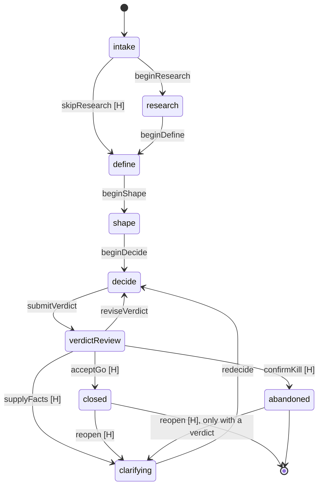
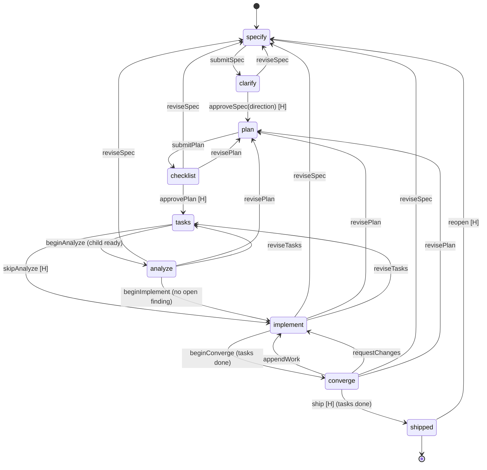
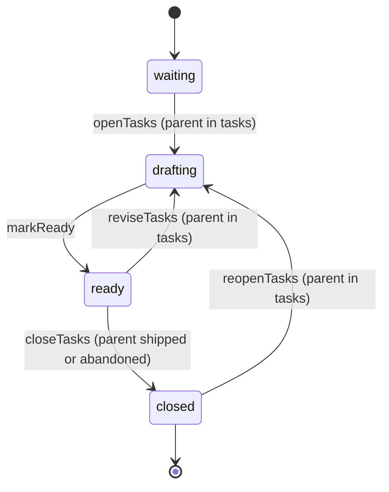
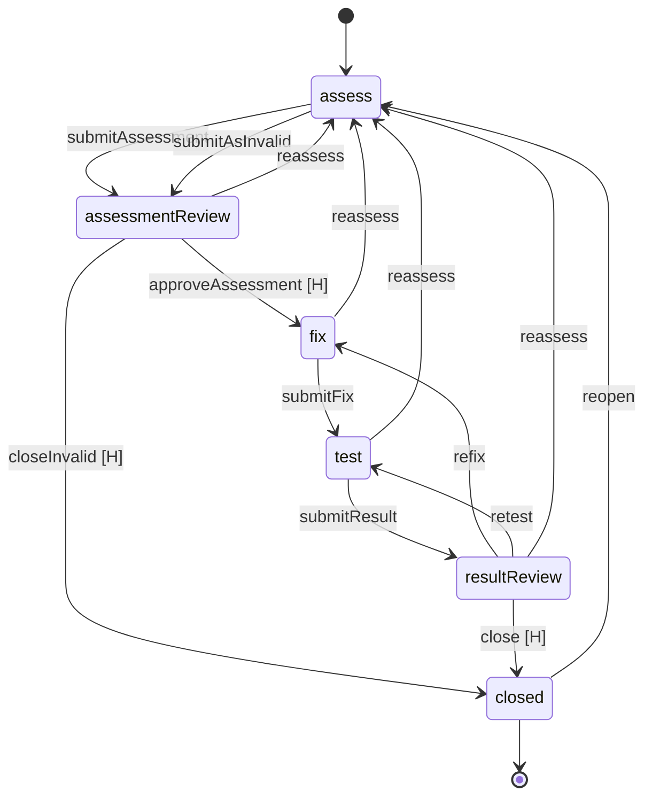

# Spec Kit on pasta: ideas, specs and bugs

Read from `github/spec-kit` at `f201054` (25 Nov 2026): the README, `docs/reference/agentic-sdd.md`,
`agentic-bugfix.md` and `agentic-assessment.md`, all 17 skills, their templates, and the three
`workflows/*/workflow.yml` files.

## 1. The workflows in one sentence each

| Page type | Workflow | Signs off | Counts as done |
|---|---|---|---|
| `speckit-idea` | A raw idea is captured, researched for and against, framed as a problem, shaped into options and given a verdict, which the user accepts, sends back with facts, or turns into a kill. | user | verdict accepted: `closed` on go, `abandoned` on kill |
| `speckit-spec` | A feature description becomes a spec the user approves, then a plan the user approves, then tasks an agent analyzes, implements and converges on until nothing is missing. | user | shipped, once converged |
| `speckit-bug` | A report is assessed against the code, the user approves the assessment before any code changes, the fix is applied and tested, and the user closes on the recorded result. | user | result reviewed and closed |
| `speckit-tasks` | The only child page. Holds the task list and the analyze findings, because pasta can gate on element states only across pages. | - | closed with its spec |

Assumptions: there is one approver, the user. Agent edges run on their own between human gates, as
Spec Kit's `workflow.yml` files do, rather than stopping after every skill as its README suggests.

## 2. How Spec Kit becomes pasta

1. **One skill is one status.** The page sits in `research` while `/speckit-assess-research` is due.
   The exceptions are `constitution` (a workspace slot) and the review statuses, which hold a gate.
2. **One output heading is one field.** A mandatory heading is in the status's exit `requires`, so the
   agent is prompted for it. A heading the template calls optional is a field outside `requires`.
3. **One file's owner is a lock.** Spec Kit says "plan never edits spec.md" and "never edit
   assessment.md". Here each field is `locked-to` the status of the skill that owns its file.
4. **`[NEEDS CLARIFICATION]` is a question element** flagged `needsHuman`. Only a human command answers it.
5. **Where Spec Kit waits for the user, the edge is human.** Where the wait collects input, the edge is
   a compound that writes the input, so the gate cannot pass without it.
6. **Everything else is an agent edge.**
7. **"All done" gates sit on the one child page.** Everything else is a section on the main page.

## 3. Mapping

### 3.1 Skills

| Spec Kit skill | Page and status | Fields it fills | Exit edge | Needs from the user |
|---|---|---|---|---|
| `/speckit-constitution` | workspace slot `constitution` | the slot text: principles, governance, version line | none | the principles |
| `/speckit-specify` | spec: `specify` | `input.description`, `stories`, `edges`, `requirements`, `success`, `assumptions`, `quality.result`, up to 3 `questions` | `submitSpec` agent | the description |
| `/speckit-clarify` | spec: `clarify` | up to 5 `questions`, answers folded into the spec fields, `quality.result` again | `approveSpec` **human** | answers, and the technical direction |
| `/speckit-plan` | spec: `plan` | `plan`, `research`, `dataModel`, `contracts`, `quickstart` | `submitPlan` agent | nothing more: the direction came with the gate |
| `/speckit-checklist` | spec: `checklist` | `checklist.items` | `approvePlan` **human** | ticks or waives each item |
| `/speckit-tasks` | spec: `tasks`, and the child | child `tasks.items`, `tasks.execution` | `beginAnalyze` agent | nothing |
| `/speckit-analyze` | spec: `analyze`, and the child | `analysis.reports`, child `findings.items` | `beginImplement` agent, guarded | only to accept a finding unfixed |
| `/speckit-implement` | spec: `implement` | marks child tasks done | `beginConverge` agent, guarded | nothing |
| `/speckit-converge` | spec: `converge` | `convergence.summaries`, appended child tasks | `appendWork` agent, while work is left | nothing |
| review, open a PR | spec: `converge` | `pull_request.url`, which any status may fill | `ship` **human**, guarded | sign-off |
| `/speckit-bug-assess` | bug: `assess` | `report`, `triage`, `symptom`, `reproduction`, `cause`, `remediation`, `questions` | `submitAssessment` agent | the report |
| review-assessment gate | bug: `assessmentReview` | none | `approveAssessment` **human** | approval, answers |
| `/speckit-bug-fix` | bug: `fix` | `fix` | `submitFix` agent | nothing |
| `/speckit-bug-test` | bug: `test` | `verification` | `submitResult` agent | nothing |
| read the result | bug: `resultReview` | none | `close` **human** | sign-off |
| `/speckit-assess-intake` | idea: `intake` | `intake`, `questions` | `beginResearch` agent | the idea |
| `/speckit-assess-research` | idea: `research` | `research`, `questions` | `beginDefine` agent | nothing |
| `/speckit-assess-define` | idea: `define` | `problem`, `questions` | `beginShape` agent | nothing |
| `/speckit-assess-shape` | idea: `shape` | `concept` | `beginDecide` agent | nothing |
| `/speckit-assess-decide` | idea: `decide` | `decision`, `handoff` | `submitVerdict` agent | nothing |
| review-verdict gate | idea: `verdictReview` | `clarifications.facts` | `acceptGo`, `confirmKill` or `supplyFacts` **human** | the verdict, or missing facts |

### 3.2 Files

| Spec Kit file | pasta |
|---|---|
| `.specify/memory/constitution.md` | workspace slot `constitution` |
| `specs/NNN-name/` | one `speckit-spec` page; the page id replaces the number and `.specify/feature.json` |
| `spec.md` | sections `input`, `stories`, `edges`, `requirements`, `success`, `assumptions` |
| `spec.md` Clarifications | section `questions`; the session date is the page's history |
| `checklists/requirements.md` | `quality.criteria` (fixed text) and `quality.result` |
| `plan.md` | section `plan` |
| `research.md` (plan) | `research.decisions` |
| `data-model.md`, `contracts/`, `quickstart.md` | `dataModel.entities`, `contracts.items`, `quickstart.guide` |
| `checklists/<domain>.md` | `checklist.items`, grouped by its `domain` field |
| `tasks.md` | child `speckit-tasks`, section `tasks` |
| analyze report (chat only in Spec Kit) | `analysis.reports`, and child `findings.items` |
| converge findings (chat only in Spec Kit) | `convergence.summaries`, and child tasks with a `gapType` |
| `.specify/bugs/<slug>/` | one `speckit-bug` page: `assessment.md`, `fix.md` and `test.md` become its sections |
| `.specify/assessments/<slug>/` | one `speckit-idea` page: `intake.md`, `research.md`, `problem.md`, `concept.md` and `decision.md` become its sections |

### 3.3 Every place Spec Kit stops for the user

| Spec Kit | pasta |
|---|---|
| `specify` asks up to 3 critical questions | `questions.items` flagged `needsHuman`; `answerQuestion` is human |
| `clarify` asks up to 5, one at a time | the same list |
| `review-spec` gate, then `plan` takes the stack as its argument | one gate, `approveSpec(direction)`, which writes `plan.direction` |
| a reviewer ticks custom checklist items | `satisfyCheck` and `waiveCheck` are human |
| `review-plan` gate | `approvePlan` |
| `implement` asks "unchecked items, proceed anyway?" | asked at `approvePlan`, where the same person sees the open items |
| `analyze` leaves findings for the user to decide | `acceptFinding` is human; `beginImplement` is held while any finding is open |
| `converge` ends in review or a PR | `ship`, or `requestChanges` |
| bug `review-assessment` gate, and `fix` asking before it proceeds on an unreproduced report | `approveAssessment`, or `closeInvalid` |
| bug result `verified`, `partial` or `failed` | `close`, `refix`, `retest` or `reassess` |
| idea `review-verdict` gate | `acceptGo` to `closed`, or `confirmKill` to `abandoned` |
| `needs-clarification`: the user supplies the missing facts | `supplyFacts(stage, text)`, which writes `clarifications.facts` |
| skipping an optional stage | `skipResearch` and `skipAnalyze` are human; `clarify` and `checklist` are skipped by approving straight away |
| an unknown host: "fetch it?" | asked in chat, from the URL trust policy in the stage guidance |
| "overwrite the existing file?" | gone: fields are locked by status and the page keeps its history |

## 4. Declarations

The page types are declared in code, which is the source of truth for sections, fields, commands and edges:

| Page type | Module |
|---|---|
| `speckit-idea` | `src/pagetypes/speckit_idea.py` |
| `speckit-spec`, `speckit-tasks` | `src/pagetypes/speckit_spec.py` |
| `speckit-bug` | `src/pagetypes/speckit_bug.py` |

Field descriptions and stage guidance are Spec Kit's own text, verbatim (MIT, `src/pagetypes/SPEC_KIT_LICENSE`);
the stage guidance is in `src/pagetypes/_stage_guidance.py`. Left out of it are the parts a page replaces:
scripts, templates, slugs, file writing, hooks and completion reports. Where a status is a gate and no skill
speaks for it, the text is the gate's own message in `workflows/*/workflow.yml`, the assess README or the
reference page. Only the pull-request field and the notices are pasta's words. A notice is a fixed section on
each page that maps the files and skills Spec Kit's text names onto the page.

What the engine changed from the design above it:

- Compounds add a list element, so the technical direction, the analyze reports and the convergence summaries
  are lists: each gate or visit adds its own entry.
- A compound cannot write in a terminal status, so reopening an idea is a plain human gate, and the facts that
  go with it are added in `clarifying`.
- The URL trust policy is stage guidance at `intake`, `research` and `assess`, where Spec Kit's skills carry it,
  rather than a fixed section.

## 5. State diagrams

`abandon` (human, from every non-terminal status) is left out of the drawings. `[H]` is a human edge.

## 6. Walk-through on arrival

Every status also lists `abandon` under humanGates, except on `speckit-tasks`.

**speckit-idea**

| status | do | blocked | humanGates |
|---|---|---|---|
| `intake` | fill intake: source, type, captured, restated, origin / questions: items | beginResearch (its fields) | skipResearch |
| `research` | fill research: confidence, findings, against | beginDefine (its fields) | none |
| `define` | fill problem: statement, users, stakeholders, goals, nonGoals, metrics, inaction | beginShape (its fields) | none |
| `shape` | fill concept: options, recommended, recommendation, outOfScope, assumptions | beginDecide (its fields) | none |
| `decide` | fill decision: verdict, scorecard, rationale | submitVerdict (its fields) | none |
| `verdictReview` | fill handoff: summary; reviseVerdict | none | acceptGo (needs the handoff), confirmKill, supplyFacts(stage, text) |
| `clarifying` | redecide | none | none |

**speckit-spec**

| status | do | blocked | humanGates |
|---|---|---|---|
| `specify` | fill input: description / stories: items / edges: items / requirements: functional / success: outcomes / assumptions: items / quality: result | submitSpec (its fields) | none |
| `clarify` | reviseSpec | none | approveSpec(direction) |
| `plan` | fill plan: summary, context, constitutionCheck, structure / research: decisions / quickstart: guide | submitPlan (its fields) | none |
| `checklist` | reviseSpec; revisePlan | none | approvePlan |
| `tasks` | nothing; the work is on the child | beginAnalyze (child ready) | skipAnalyze, once the child is ready |
| `analyze` | beginImplement(report); reviseSpec; revisePlan; reviseTasks | none; beginImplement once a finding is recorded, until every one is resolved or accepted | none |
| `implement` | reviseSpec; revisePlan; reviseTasks | beginConverge (child tasks done/skipped) | none |
| `converge` | fill convergence: summaries; appendWork(summary); requestChanges; reviseSpec; revisePlan | none | ship (needs the summary; held once a task is appended, until it is done) |

**speckit-tasks**

| status | do | blocked | humanGates |
|---|---|---|---|
| `waiting` | nothing | openTasks (parent in tasks) | none |
| `drafting` | fill tasks: items, execution | markReady (its fields) | none |
| `ready` | reviseTasks, while the parent is in tasks | closeTasks (parent in shipped/abandoned) | none |

**speckit-bug**

| status | do | blocked | humanGates |
|---|---|---|---|
| `assess` | fill report: source, body / triage: verdict, severity, rationale / symptom: body / reproduction: steps / cause: codePaths, hypothesis, confidence / remediation: preferred, files, tests, risks | submitAssessment (its fields); submitAsInvalid (its fields) | none |
| `assessmentReview` | reassess | none | approveAssessment (needs a remediation, so never on an invalid report), closeInvalid |
| `fix` | fill fix: status, summary, changes, tests, verification; reassess | submitFix (its fields) | none |
| `test` | fill verification: result, summary, checks, recommendation; reassess | submitResult (its fields) | none |
| `resultReview` | refix; retest; reassess | none | close |

Every open question flagged `needsHuman` also shows under attention on its page, at any status.

## 7. Timeline

Proposed, and not done yet: draw `speckit-idea`, `speckit-spec` and `speckit-bug`; leave `speckit-tasks` off, since its life is its spec's.

| Type | Line colour | Why |
|---|---|---|
| `speckit-idea` | amber | a question, before any building |
| `speckit-spec` | teal | the main line; cool against the pink theme |
| `speckit-bug` | vermilion | reads as a defect without matching amber |

The three existing lines are theme tokens whose values I did not read, so check these against them in
both themes. Every terminal status is one the Timeline already ends a line on: `shipped` and `closed` as
delivered, `abandoned` as dropped. So a killed idea draws as dropped, like one given up halfway, and
`decision.verdict` tells the two apart. It is also what lets only an idea that reached a verdict reopen.

## 8. What the model cannot express

None of these blocks the design; each names what stands in for it.

- `EXTENSION:` a same-page guard on element states (`questions.items all in {answered, deferred}`) - `plan` must not start with an unresolved clarification. Stands in: the human `approveSpec` gate.
- `EXTENSION:` a `requires` that wants content written in this visit - a send-back leaves the old content in place, so the exit is legal at once. Stands in: `beginImplement` and `appendWork` are compounds that take a fresh report, since those stages repeat by design; `ship` is the user's and reads the summary on the page, so its instruction says to rewrite it every pass; elsewhere the guidance says to clear the lists first.
- `EXTENSION:` a guard on a field's value - a go needs adequate evidence, and a `failed` result must not be closed. Stands in: the human gates, and the instructions.
- `EXTENSION:` list elements seeded by the type - the quality criteria and the six scorecard rows are fixed sets. Stands in: fixed text, and an enum with "one entry for each".
- `EXTENSION:` a checked reference to an element on the same page - acceptance scenarios belong to a story. Stands in: scenarios numbered inside the story.

Three behaviours the design relied on hold in the store:

- A child guard can read the child's status, as `feature-brief` does when it waits for both plans to be ready.
- A child guard over an empty list passes while the child is live, so `beginImplement` passes when analyze finds nothing.
- A checked reference may be left out, so `storyId` is absent on setup, foundational and polish tasks.

## 9. Self-check

| Check | Answer |
|---|---|
| Says when to use it and what instead | Yes, on all four. |
| Every status reachable, every non-terminal has an exit | Yes, checked by script. |
| Field work in the exit `requires`, the rest in guidance | Yes, or an argument of the exit compound (`approveSpec`, `beginImplement`, `appendWork`). Optional by Spec Kit's own templates, so outside `requires`: `research.sources`, `requirements.entities`, `plan.complexity`, `dataModel.entities`, `contracts.items`, `checklist.items`, `remediation.alternatives`, `fix.highlights`, `fix.deviations`, `fix.followUps`, `verification.excerpts`, `verification.residualRisks`; and `handoff.summary` in `decide`, which is for go only. |
| Human gates exactly at sign-off, abandon is human | Yes, see 3.3. |
| Every review stage has a send-back | `clarify`, `checklist`, `analyze`, `converge`, `assessmentReview`, `resultReview`, `verdictReview`: yes. |
| Instructions a stranger can act on | Yes. |
| Locks are deliberate | Each field is locked to the status of the skill that owns its file. `questions` is unlocked so any stage can ask, and `pull_request.url` names every status, the terminal ones included, so any of them can fill it. |
| "All done" gates use a child and a guard | `tasks.items` and `findings.items` on `speckit-tasks`. |
| Guarded children exist when checked | `speckit-tasks` is pinned, so it exists from the start. |
| Inexpressible things marked | Section 8. |

Known noise: `do` unions the setters of every exit. `assess` prompts for the remediation even when the
report is invalid, and `verdictReview` prompts for the handoff even on a kill. The guidance says which to write.

## 10. Left out on purpose

- File mechanics: slugs, path and symlink checks, template resolution, `feature.json`, overwrite prompts. The page id and the locks replace them.
- Extension hooks (`before_*`, `after_*`), the git extension and `taskstoissues`. Workspace slots cover the parts a team would keep.
- Commits, which `feature-brief` and `bug-report` record, and a pull-request URL on the bug page: no skill writes them. The spec page has the URL by choice.
- Deciding without a concept, which `assess.decide` allows but may not call go. Here `shape` always comes first and may recommend none.
- A constitution page. The slot pushes the text to the agent at the statuses whose skills load it, but it has no amendment gate or history; use a `document` page if you want those.
